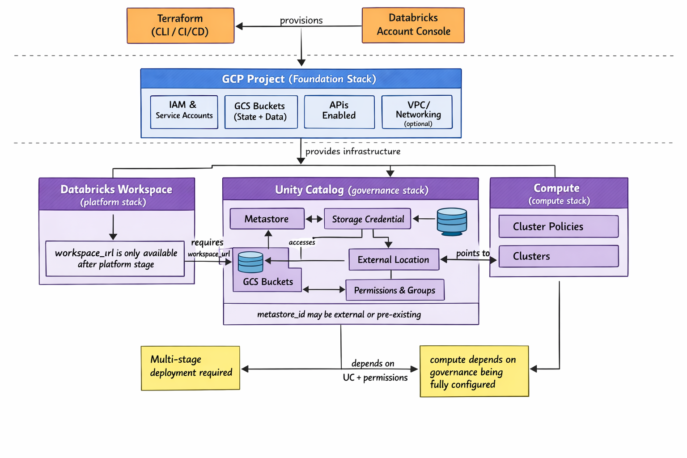

# Architecture — GCP + Databricks Platform

## Overview

This document describes the **high-level architecture** of the Terraform project responsible for provisioning a **data platform on GCP integrated with Databricks**.

The architecture follows:

* A **modular stack-based design**
* A **multi-stage deployment strategy**
* A **dual-layer authentication model (GCP + Databricks)**

---

## Architecture Diagram



> The diagram combines a **C4-style view (system + containers)** with the **real deployment dependency flow** used by Terraform.

---

## Architecture Layers

The platform is divided into three main layers:

---

### 1. External / Control Layer

This layer represents the orchestration and control plane.

**Components:**

* Terraform CLI / CI/CD pipelines
* Databricks Account Console

**Responsibilities:**

* Trigger infrastructure provisioning
* Manage account-level Databricks resources
* Provide authentication context

---

### 2. GCP Infrastructure Layer (Foundation)

This layer is responsible for the **core cloud infrastructure**.

**Managed by:** `foundation stack`

**Components:**

* IAM & Service Accounts
* GCS Buckets (Terraform state and data storage)
* Enabled APIs
* Optional networking (VPC, NAT, firewall)

**Responsibilities:**

* Provide identity and access control
* Store data and state securely
* Enable required GCP services
* Serve as the base for Databricks integration

---

### 3. Databricks Platform Layer

This layer represents the **data platform itself**, divided into logical stacks.

---

#### 3.1 Platform (Workspace)

**Managed by:** `platform stack`

**Components:**

* Databricks Workspace (account-level resource)

**Responsibilities:**

* Create the workspace
* Establish the bridge between GCP and Databricks
* Provide the `workspace_url` required by subsequent stages

---

#### 3.2 Governance (Unity Catalog)

**Managed by:** `governance stack`

**Components:**

* Metastore
* Storage Credentials (GCS)
* External Locations
* Catalogs and Schemas
* Permissions and Groups

**Responsibilities:**

* Define data governance rules
* Control access to storage and datasets
* Structure data using Unity Catalog
* Manage RBAC (Role-Based Access Control)

---

#### 3.3 Compute

**Managed by:** `compute stack`

**Components:**

* Cluster Policies
* Databricks Clusters

**Responsibilities:**

* Provide execution environments for data workloads
* Enforce cluster configuration standards
* Enable scalable data processing

---

## Deployment Dependency Flow

The platform is provisioned using a **strict multi-stage dependency flow**:

```
Foundation → Platform → Governance → Compute
```

### Key Dependencies

| Stage      | Depends On                        |
| ---------- | --------------------------------- |
| Platform   | Foundation                        |
| Governance | Platform (requires workspace URL) |
| Compute    | Governance                        |

---

## Critical Constraints

### 1. Multi-Stage Deployment

The infrastructure **cannot be deployed in a single step**.

Reasons:

* `workspace_url` is only available after platform creation
* `governance` requires workspace-level provider configuration
* `compute` depends on governance resources

---

### 2. External Inputs Required

Some values must be retrieved manually:

* `databricks_workspace_host`
* `metastore_id`

These are required for governance and compute stages.

---

### 3. Dual Provider Model

The project uses two Databricks providers:

| Provider Type   | Scope                  |
| --------------- | ---------------------- |
| Account-level   | Workspace creation     |
| Workspace-level | Governance and compute |

---

## Data Flow

### Storage Integration

* GCS buckets are used as:

  * Terraform state backend
  * Data lake storage

* Databricks integrates with GCS via:

  * Storage Credentials
  * External Locations

---

## Networking (Optional)

The architecture supports:

* Databricks-managed VPC (default)
* Customer-managed VPC (advanced)

When enabled, the `network` stack provisions:

* VPC
* Subnets
* NAT
* Firewall rules
* Databricks network attachment

---

## Design Decisions

### 1. Stack-Based Separation

Each logical concern is isolated:

* Improves maintainability
* Enables partial deployments
* Reduces blast radius

---

### 2. Flag-Driven Enablement

Stacks are enabled via flags:

```
enable_foundation
enable_platform
enable_governance
enable_compute
```

This allows controlled execution per stage.

---

### 3. Opinionated Governance Layer

The Unity Catalog implementation includes:

* Predefined structures (catalogs, schemas)
* Default permissions
* Standardized storage configuration

---

## Summary

This architecture provides a **scalable, modular, and enterprise-ready foundation** for a Databricks-based data platform on GCP.

Key characteristics:

* Clear separation of concerns
* Controlled multi-stage deployment
* Strong governance model
* Flexible networking options

---

## Related Documents

* `run-dev.md` — DEV environment execution
* `deployment-flow.md` — Detailed deployment strategy
* `module-responsibilities.md` — Module breakdown
* `bootstrap.md` — Backend setup

---
