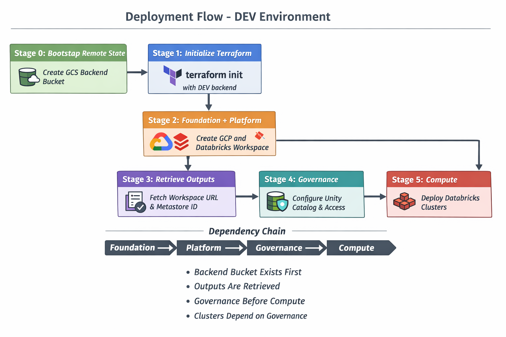

# Deployment Flow — DEV Environment

## Overview

This document describes the **deployment flow** of the Terraform project for the GCP + Databricks platform.

The provisioning process is intentionally **multi-stage**. It cannot be executed as a single end-to-end `terraform apply`, because some stages depend on outputs or externally retrieved values generated by previous stages.

This document focuses on the **logical deployment sequence**, the **dependencies between stages**, and the **reasoning behind the execution order**.

---

## Deployment Flow Diagram



> The diagram illustrates the real execution sequence and the dependency chain between Terraform stages.

---

## Why the Deployment Is Multi-Stage

The infrastructure is divided into logical stacks, but these stacks are not fully independent.

Some Databricks resources are provisioned at the **account level**, while others are provisioned at the **workspace level**. In addition, some required inputs are only known after earlier stages complete.

Examples:

- The Databricks workspace URL is only available after the workspace is created.
- Governance resources require a workspace-scoped Databricks provider.
- Compute resources depend on governance resources already being in place.
- The metastore identifier may be externally managed or pre-existing.

Because of these constraints, the recommended deployment flow is executed in controlled stages.

---

## High-Level Sequence

The official sequence for DEV is:

```text
Bootstrap → Init → Foundation + Platform → Retrieve Outputs → Governance → Compute
````

---

## Stage 0 — Bootstrap Remote State

### Purpose

Create the remote backend storage used by Terraform state.

### Why this stage exists

Terraform requires the backend bucket to exist **before** running `terraform init` with the remote backend configuration.

### Expected result

A GCS bucket is created and ready to store Terraform state for the DEV environment.

### Notes

This is a prerequisite stage and is usually executed once per environment or once per platform initialization strategy.

---

## Stage 1 — Initialize Terraform Backend

### Purpose

Initialize Terraform using the DEV backend configuration.

### Why this stage exists

The project uses a remote GCS backend. After the backend bucket exists, Terraform must be initialized against the correct backend file.

### Expected result

Terraform is initialized and connected to the DEV remote state.

### Notes

This stage must happen after backend bootstrap and before any `plan` or `apply`.

---

## Stage 2 — Foundation + Platform

### Purpose

Provision the cloud base and create the Databricks workspace.

### Included stacks

* `foundation`
* `platform`

### What is created in this stage

Typical resources include:

* GCP IAM and service accounts
* GCP APIs
* GCS buckets
* Optional GCP base networking components
* Databricks workspace (account-level resource)

### Why this stage comes first

All later Databricks workspace-level resources depend on the workspace existing first.

### Expected result

The workspace is created and Terraform can expose the platform outputs, including the workspace URL.

---

## Stage 3 — Retrieve Required Outputs

### Purpose

Collect values that are required by later stages.

### Required values

Typical values include:

* `workspace_url`
* `metastore_id`

### Why this stage exists

These values may not be known at the start of the deployment.

The workspace URL is produced after the platform stage.
The metastore identifier may need to be retrieved from the Databricks account console when a pre-existing metastore is used.

### Expected result

All required inputs for governance are available.

### Notes

This is one of the main reasons the deployment is not single-pass.

---

## Stage 4 — Governance

### Purpose

Provision the data governance layer inside the Databricks workspace.

### Included stack

* `governance`

### What is created in this stage

Typical resources include:

* Unity Catalog metastore assignment
* Storage credentials
* External locations
* Catalogs and schemas
* Permissions and grants
* Identity and entitlement configuration

### Why this stage depends on previous stages

Governance requires:

* A Databricks workspace to already exist
* A workspace-level provider host
* Storage resources from GCP foundation
* A metastore ID when not creating a new one

### Expected result

The governance layer is active and the workspace is ready for secure data access and structured platform usage.

---

## Stage 5 — Compute

### Purpose

Provision compute resources for workloads.

### Included stack

* `compute`

### What is created in this stage

Typical resources include:

* Cluster policies
* Databricks clusters

### Why this stage comes last

Compute depends on governance because clusters must be created in a workspace that already has:

* Proper permissions
* Required data access structures
* Unity Catalog configuration
* Standardized policy expectations

### Expected result

The DEV environment is ready to run workloads on governed compute infrastructure.

---

## Dependency Model

The real dependency chain is:

```text
Foundation → Platform → Governance → Compute
```

### Dependency details

#### Foundation → Platform

The platform layer depends on the existence of GCP resources such as IAM, APIs, and storage foundations.

#### Platform → Governance

The governance layer depends on the Databricks workspace and requires the workspace host URL.

#### Governance → Compute

The compute layer depends on governance resources, permissions, and workspace configuration being ready first.

---

## Manual Inputs and External Dependencies

Some steps require values or operations that are not fully produced inside a single Terraform execution.

### Databricks Account Configuration

Before running workspace and governance-related stages, the appropriate service account or service principal must already be configured in the Databricks account.

This may include:

* Registering the principal in the Databricks account console
* Assigning appropriate account-level privileges
* Ensuring the identity can authenticate against Databricks providers

### Workspace URL

The workspace URL is needed by workspace-scoped provider configuration and is only known after the platform stage.

### Metastore ID

When using an existing metastore, the metastore ID must be provided explicitly.

---

## Recommended Execution Strategy for DEV

The recommended operational flow is:

### Step 1

Bootstrap the backend bucket.

### Step 2

Initialize Terraform with the DEV backend.

### Step 3

Run `foundation + platform`.

### Step 4

Read outputs and capture the workspace URL.

### Step 5

Obtain or confirm the metastore ID.

### Step 6

Run `governance`.

### Step 7

Run `compute`.

This staged approach reduces risk and makes troubleshooting easier.

---

## Operational Advantages of the Staged Flow

Using a staged deployment process provides practical benefits:

* Clear separation of responsibilities
* Easier debugging
* Safer rollout of platform-critical resources
* Better visibility into outputs between phases
* Lower risk of partial failures across mixed account/workspace scopes

---

## Common Failure Points

### Remote backend not created

Terraform initialization fails because the backend bucket does not yet exist.

### Missing Google credentials

Terraform planning fails because the Databricks provider expects Google credentials or a path to them.

### Workspace host not provided

Governance fails because workspace-scoped Databricks resources require the workspace URL.

### Invalid or missing metastore ID

Governance fails when an existing metastore is expected but the identifier is incorrect or absent.

### Databricks account identity not configured

Platform or governance stages fail if the service account/service principal is not properly registered in the Databricks account.

---

## Design Rationale

The deployment flow reflects the architecture of the platform rather than an implementation limitation.

The project intentionally separates:

* cloud foundation provisioning,
* account-level Databricks provisioning,
* workspace governance,
* compute activation.

This separation improves maintainability, operational clarity, and long-term extensibility.

---

## Summary

The Terraform deployment flow for DEV is intentionally staged.

The correct sequence is:

```text
Bootstrap → Init → Foundation + Platform → Retrieve Outputs → Governance → Compute
```

This flow ensures that:

* dependencies are resolved in the correct order,
* workspace-scoped resources are only created after the workspace exists,
* governance is established before compute is activated,
* operational execution remains predictable and supportable.

---

## Related Documents

* `run-dev.md` — DEV execution guide
* `architecture.md` — High-level architecture
* `bootstrap.md` — Remote backend setup
* `module-responsibilities.md` — Stack and module ownership